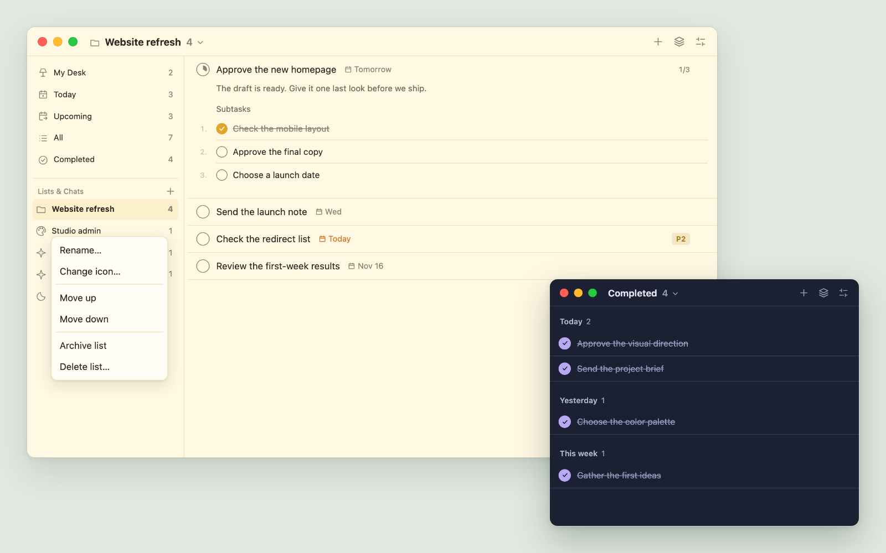
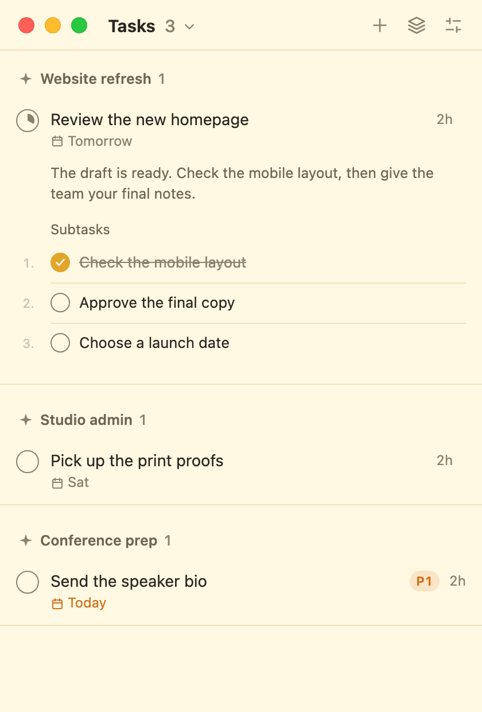
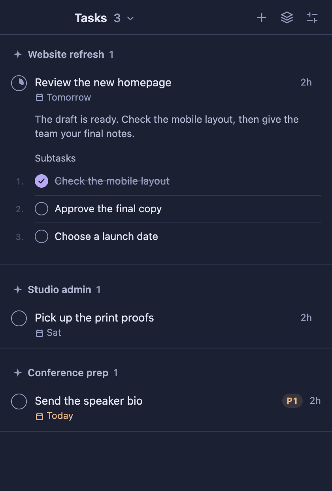
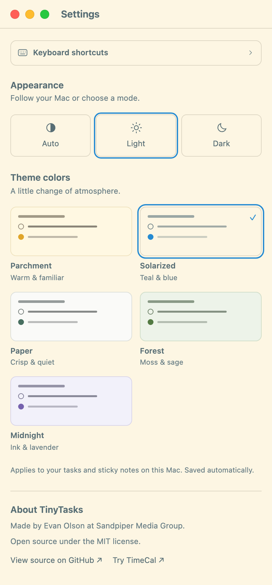
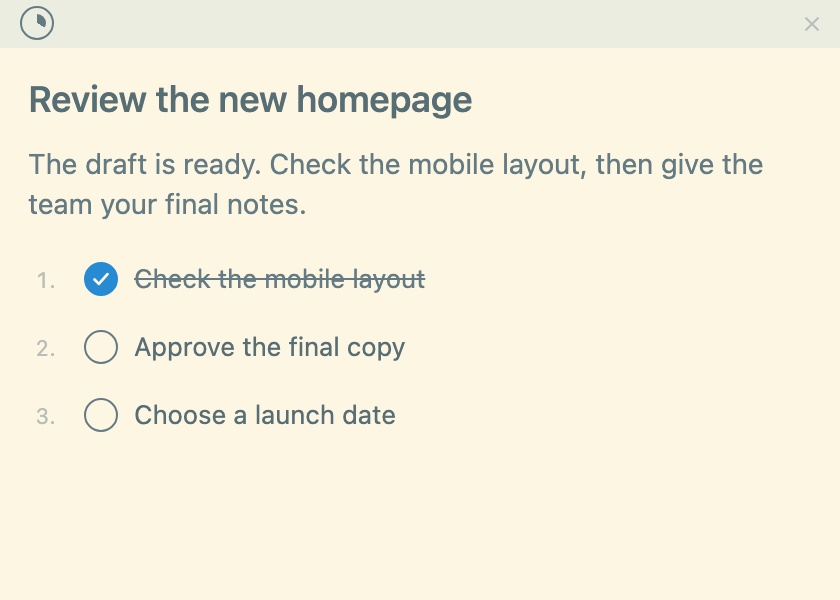
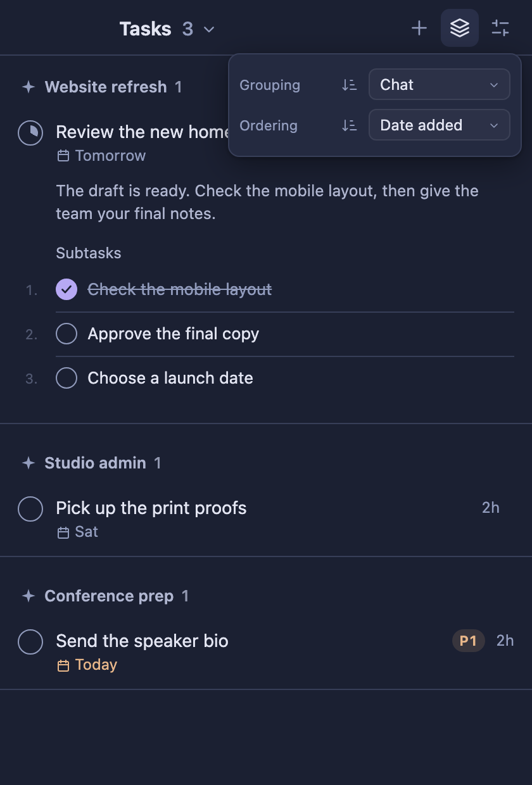
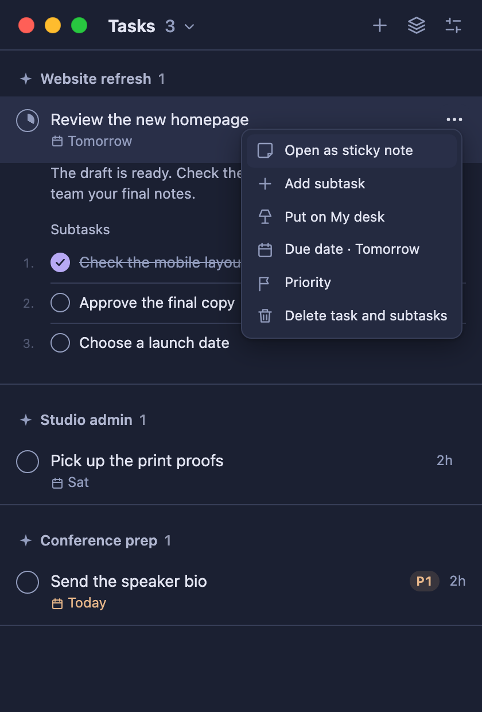

# TinyTasks

A sticky note for the things your AI agents tell **you** to do.

When an agent hands you a to-do ("add the API key in Vercel", "approve the PR"), it drops it on
TinyTasks over MCP. You get a desktop notification, the tray icon shows how many are open, and you
check them off. The agent can see what you finished. Keep related steps together as subtasks.

Built with Rust + [Tauri](https://tauri.app). Runs on Windows and macOS. The current subtask
and sticky-note interactions have been checked on macOS; Windows still needs that regression pass.

## Set it up with your agent

Give your Dot, Claude, Codex, or other agent this repository URL and ask:

> Set up TinyTasks for me: https://github.com/SandpiperMediaGroup/tinytasks
> Follow its agent setup guide, ask where I want to keep my task list, connect the agents I use,
> and remember when to use TinyTasks for my action items.

**Agents: start with the [agent setup guide](docs/agent-setup.md).** It covers installation,
choosing the task folder, connecting tools, checking access, and saving a durable usage instruction.
Do not assume the user wants the default folder or that every agent has the same configuration.

For multiple computers, we recommend a dedicated **TinyTasks folder in a cloud-synced drive**
you already use, such as Google Drive, Dropbox, OneDrive, or iCloud Drive. Each computer runs
its own app and selects its local copy of that shared folder. A local-only folder works too.
This folder holds your `tasks.md`; you do not need to keep the source-code checkout there.

## Download for Windows

Download the Windows x64 setup executable from the [latest release](https://github.com/SandpiperMediaGroup/tinytasks/releases/latest)
and run it. A portable ZIP is also available; extract it to a permanent folder before connecting your agents.
Settings shows the installed executable path and a copyable MCP configuration. Updates are checked daily
and can also be checked manually in Settings; installing a new release is manual.

## Download for Mac

Download the universal Mac DMG from the [latest release](https://github.com/SandpiperMediaGroup/tinytasks/releases/latest),
open it, and drag **TinyTasks.app** to **Applications** before launching it. A ZIP download is also available.
Both the app and DMG are Developer ID signed, notarized by Apple, and carry their notarization tickets.
The app supports Apple silicon and Intel Macs. v0.2.1 includes the new sidebar and
list-management improvements on both Windows and macOS.

For MCP setup, the installed Mac executable is `/Applications/TinyTasks.app/Contents/MacOS/tinytasks`.
See [Connect your agents](#connect-your-agents) below. Release maintainers can follow [the release guide](docs/RELEASING.md).

## A look inside

The latest sidebar, list actions, and completion-date groups, shown with sample tasks:



Task lists, ordered subtasks, and quiet task menus. These previews use sample tasks.

| Parchment · Light | Midnight · Dark |
| --- | --- |
|  |  |

### Themes and Settings

Choose **Parchment, Solarized, Paper, Forest, or Midnight**, then choose **Auto, Light, or Dark**
independently. Every theme supports both appearances. Auto follows your computer; changes update
both your task list and sticky notes. Settings opens in its own window and includes a keyboard
shortcut guide, creator credits, and links to this repository and TimeCal.

| Settings | Solarized sticky note |
| --- | --- |
|  |  |

### Compact controls

Group and order your list, choose which properties appear, and open task actions from **⋯**
or a right-click. Group headers collapse on click; hover reveals the less-used controls.

| Grouping and ordering | Task actions |
| --- | --- |
|  |  |

## Using it

On macOS, the task controls share one compact row with the window’s traffic lights.
Drag the empty header space to move the window.

- **Click a task's text** to edit it directly. Click away or press Enter to save a title;
  use Ctrl/Cmd+Enter for details. Escape cancels. Click the rest of the row to open its details.
  Click the empty gutter or space beneath expanded details to collapse the task again.
- **Open a sticky note** from the task’s **⋯** menu, using the folded-corner note icon. Notes
  use a plain paper surface with text, checkboxes, and subtasks, without the list toolbar,
  metadata, or action strip. The main completion circle sits at the left of the top strip;
  the title and description stay aligned with the note edge, including while editing. Drag the thin top edge to move a note; its quiet close button
  becomes clearer on hover or keyboard focus. Notes use normal window stacking, and edits sync with the list.
  Close a note to dismiss it without deleting the task. Notes last for the current app session;
  use the menu’s note action again to reopen one.
- **Display properties** (the sliders at the top right) lets you show or hide ID, agent,
  chat, priority, due date, added/completed time, and a details preview. Choices are remembered.
  Hover the row’s action button for the full added date; completed tasks also show their completion date.
- **Settings** opens in its own window from the Tasks menu (⌘, on Mac; Ctrl+, elsewhere).
  Your task list stays visible; reopening Settings brings the existing window forward. Expand **Keyboard shortcuts**
  for a guide to navigation, editing, task actions, subtask ordering, and sticky notes. Choose Auto, Light, or Dark separately from the theme colors:
  Parchment, Solarized, Paper, Forest, or Midnight. Every palette has both light and dark modes;
  Auto follows the computer’s appearance while keeping your selected palette. The choice saves automatically and updates open sticky notes on this computer.
  The About section credits Evan Olson and Sandpiper Media Group, links to this open-source repository,
  and offers a link to [try TimeCal](https://trytimecal.com).
- **+** adds your own task. The entry field wraps and grows as you type; Enter saves and Escape cancels. Subtask entry works the same way. Agents see those too.
- **Priority** (P0 to P3) and a **due date** can be set by you (flag and calendar in the task menu)
  or by the agent.
- **My Desk** is today's arrangement of existing tasks. An agent can suggest a plan for you to
  **Accept** or **Decline** as a whole. A suggestion does not replace your current desk until
  accepted. Add existing tasks with **+** or the lamp action in a task’s menu.
  Set start times and optional durations in the separate left gutter; these never change due dates.
  The timeline shows task spans and start-time dots, plus the current time. Work start/end hours
  are in **Settings → My Desk**. The desk and pending suggestions clear overnight; your tasks
  stay in their lists. See [My Desk and agent arrangements](docs/my-desk.md).
- **Click the title** to switch between Tasks, My desk and Completed, or to change where the list
  is kept.
- **Show sidebar**, in the title menu or Settings, expands a narrow window to show My Desk,
  Today, Upcoming, All, Completed, and your Lists & Chats, including Personal tasks. Drag the
  divider to resize it. Drag list names to reorder them; the five main views stay fixed.
  Right-click a list to rename it, change its icon, archive it, or delete it. Empty lists stay
  in the sidebar and are hidden in All. An open list shows its icon in the toolbar without
  repeating its name as a group heading. See [Lists & Chats](docs/lists-and-navigation.md).
- **Archive list** moves its original Markdown sections, including completed tasks, subtasks,
  and notes, to `archive.md` beside `tasks.md`. Deleting a list instead asks for confirmation.
- **Grouping and ordering** share a compact two-row menu. Group by date added, chat, agent,
  priority, due date, or choose No grouping. Order tasks within each group by priority, due date,
  date added, or name; Completed also offers date completed. Each row has a direction control.
  Missing dates and priorities stay last. Task views and Completed remember their own
  choices and collapsed groups. My Desk follows its start times, with unscheduled items last.
  Subtasks keep their saved order.
  Completed also offers grouping by **Date completed**, with Today, Yesterday, This week,
  and Earlier headings.
- **Subtasks** live in a task's details. Use **Add subtask** in the task’s **⋯** menu to add the
  first one; the Subtasks header appears once needed, with its own **+** for more. Click its
  text to edit, or the rest of its row to open its own details. Its **⋯** menu manages its priority, due date, and sticky note.
  Use the small **1 / •** chip to switch between numbered steps and a checklist.
- **Drag subtasks** to reorder them, or focus a subtask row and press Alt+Up/Down. Both modes
  remember the same order. Numbers stay muted; the parent's circle shows completion progress.
  Checking a parent completes its remaining subtasks. Checking a subtask leaves the parent
  open; reopening a child also reopens its parent. Deleting a parent deletes its subtasks.
- **Hover controls**: group chevrons appear over their header; the subtask **+** and mode chip
  appear over the Subtasks header. Keyboard focus reveals them too, and touch devices keep
  them visible. Hover or focus a task row to reveal **⋯** in place of its priority/time badges.
  Click it, right-click a row, or press Shift+F10 for the same custom menu with icons.
  Expanded details contain only the description and subtasks; editing text keeps the standard text context menu.

Subtasks support one level of nesting. Completed steps stay under their parent, and list/tray
counts count top-level tasks. My desk counts and shows the individual tasks and subtasks selected
for it. A selected subtask appears on its own with a curved branch arrow and its parent's name;
its parent and siblings are not automatically added to the desk.

## Build

Needs [Rust](https://rustup.rs) and the [Tauri prerequisites](https://v2.tauri.app/start/prerequisites/)
for your operating system.

```bash
cargo build --release
```

Run `target/release/tinytasks` and it opens. For an installer (and on macOS, where notifications
need a bundled `.app`), use `cargo install tauri-cli --version "^2"` then `cargo tauri build`.

## Connect your agents

The same binary is the MCP server: `tinytasks mcp`, using local stdio transport. Adding tasks
through MCP starts the app if it isn't running. Use the installed executable's absolute path.
For a macOS app installed in Applications, that is
`/Applications/TinyTasks.app/Contents/MacOS/tinytasks`; on Windows, use the installed `tinytasks.exe`.
The GitHub URL is the setup entry point, not an MCP server endpoint.

Claude Code:

```bash
claude mcp add --scope user tinytasks -- /absolute/path/to/tinytasks mcp
```

Codex:

```bash
codex mcp add tinytasks -- /absolute/path/to/tinytasks mcp
```

Dot, Claude Desktop, and other clients: use the client's local MCP settings and the same command
and `mcp` argument. Discover its supported setup flow; the Claude Code command above does not
configure Claude Desktop. For clients accepting the `mcpServers` JSON format:

```json
{ "mcpServers": { "tinytasks": { "command": "/absolute/path/to/tinytasks", "args": ["mcp"] } } }
```

Agents get `add_tasks`, `list_tasks`, `update_task`, `complete_tasks`, `remove_tasks` and
`get_desk`, `suggest_desk`, `set_desk`, plus `reorder_subtasks`. `set_desk` is an untimed
suggestion shortcut; both desk-writing tools wait for user review. Tool access and remembering
to use it are separate steps.
Save the following in each agent's supported persistent memory or instructions (for example,
`CLAUDE.md` or `AGENTS.md`, at the scope where you want it to apply):

> Use TinyTasks for action items I, the human, need to do. Check existing tasks first to avoid
> duplicates. Keep your own agent work plan elsewhere. Use the actual originating conversation
> title in `chat` whenever available and include a real conversation link if you have one.
> Reuse that title consistently; if unavailable, use a concise descriptive fallback.
> Use priority sparingly: omit it by default and set it only for clear urgency or my explicit request.
> Use subtasks for related steps toward one outcome, ordered when sequence matters and a checklist
> otherwise. Keep independent actions separate. Create the parent first, then add its steps with
> `parent_id`. When resuming, use `list_tasks` to see what I've finished. Only mark tasks complete
> when I say they're done or you have verified the outcome. When I ask what to focus on, use
> `get_desk` for my local date and work hours, then `suggest_desk` with existing open task IDs,
> start times, and optional durations. Keep the plan realistic. I accept or decline the whole
> arrangement in My Desk; a suggestion is not an accepted plan. Desk times are separate from
> due dates, and the desk resets each day. Report a failed write rather than claiming success.

After connecting a client, start a new chat or reload its tools, then verify `list_tasks` works.
See the [setup guide](docs/agent-setup.md) for cloud-file-only agents and a complete setup check.

To add steps, call `add_tasks` with an existing `parent_id` and a `tasks` array. Array order
becomes the sibling order, and the parent supplies the chat and default conversation link.
Set `ordered: true` for numbered steps, or change the parent's mode later with `update_task`.
Read `list_tasks` with `parent_id` to get all children in saved order (including older completed
steps), then call `reorder_subtasks` with `parent_id` and every child ID exactly once in `ids`.
Stale, duplicate, missing, or unrelated IDs are rejected without changing the file.

## Your list is a markdown file

Tasks live in `~/.tinytasks/tasks.md`. To keep them somewhere else, like a Google Drive folder,
click the title and choose **Change folder…**. Your list moves there, or, if that folder already
has one (from your other computer, say), TinyTasks uses it. Each computer notifies you once per
new task.

Keep the shared folder available offline on each computer and let sync finish before switching
between them. TinyTasks locks writes on one machine; cloud sync does not coordinate simultaneous
writes from different computers. Conflicted copies need reconciliation. Local settings and locks
stay in `~/.tinytasks`; sync the chosen task-data folder, not that settings directory.

Agents that can read your Drive but can't run the MCP server can then read and update the list
too: the file starts with a short comment explaining the format to them. If the folder goes
missing (the sync app isn't running), TinyTasks says so rather than starting a new list.

```markdown
## Stripe billing setup

- [ ] Add the STRIPE_KEY secret in Vercel @priority(1) @due(2026-11-06) @mydesk(2026-11-04) @from(claude-code) @added(2026-11-04 10:12) @id(7)
  Details go on indented lines under the task.
- [x] Approve the PR @from(codex) @added(2026-11-04 09:49) @done(2026-11-04 10:12) @id(4)
```

| In the file | Means |
|---|---|
| `## Heading` | The chat the tasks under it came from |
| `@priority(0-3)` | 0 is most urgent |
| `@due(YYYY-MM-DD)` | Due date |
| `@mydesk(YYYY-MM-DD)` | On your desk that day only; `@mydesk(today)` gets the date filled in |
| `@from(agent)` | Who added it; none means you did |
| `@link(url)` | Back to the chat |
| `@added`, `@done` | When, as `YYYY-MM-DD HH:MM` |
| `@id(n)` | Unique; filled in for tasks you type yourself |
| `@parent(id)` | The parent task's ID; one level of subtasks |
| `@position(n)` | Zero-based sibling order, used in both checklist and numbered modes |
| `@subtasks(ordered)` | On the parent: display its children as numbered steps |

TinyTasks keeps anything it doesn't use (other `@tags`, notes) exactly as you wrote it, and
grouping and sorting in the window never reorder the file.
Subtasks remain top-level checkbox lines in the file; the parent/position attributes describe
their hierarchy. Indented lines remain task details. A missing, self-referencing, or nested
parent link is recovered as an ordinary task so it cannot disappear from the list.

## Checks

`cargo test --offline` covers Markdown round trips, subtasks, daily desk expiry, and arrangement
validation and review. After `cargo build`,
run `python3 scripts/mcp-smoke.py` for the real agent protocol with temporary task/state folders.
With Playwright installed, `node scripts/ui-smoke.cjs` exercises the UI with a mocked desktop
bridge. `PLAYWRIGHT_MODULE` and `PLAYWRIGHT_CHROMIUM_EXECUTABLE` may point to an existing install.
`TINYTASKS_DATA_DIR` overrides the local settings/lock folder for isolated development checks.

`node scripts/docs-screenshots.cjs` refreshes the README previews from the current UI using fictional
tasks. It uses the same Playwright overrides and does not open or modify your real task list.

## Contributing

PRs welcome. Keep it tiny.

## License

[MIT](LICENSE). Agent logos from [Simple Icons](https://simpleicons.org) (CC0) and
[Lobe Icons](https://lobehub.com/icons) (MIT); they're trademarks of their owners.
