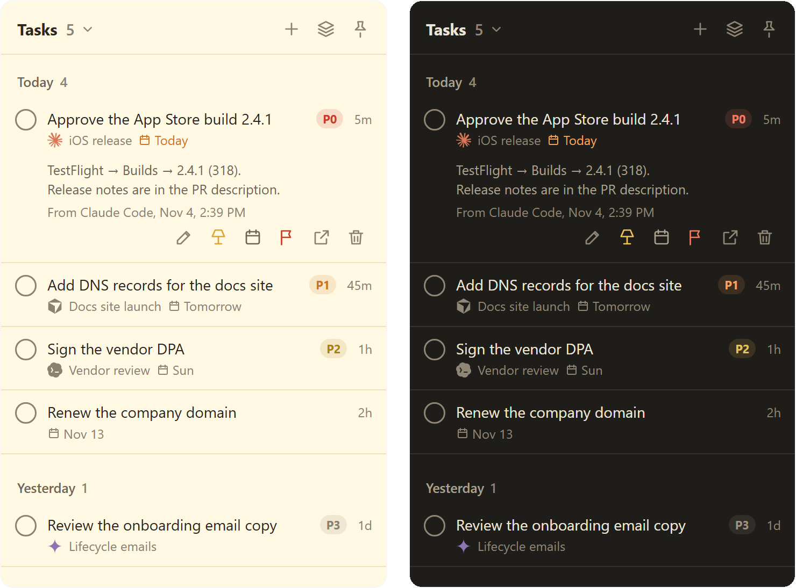

# TinyTasks

A sticky note for the things your AI agents tell **you** to do.

When an agent hands you a to-do ("add the API key in Vercel", "approve the PR"), it drops it on
TinyTasks over MCP. You get a desktop notification, the tray icon shows how many are open, and you
check them off. The agent can see what you finished. That's it: no due dates, no projects.

You can add your own with **+** too, and agents see those as well. Tasks can have a priority
(P0 to P3) and a due date, set by you or the agent. Ask an agent what to focus on and it puts a
few things on your **desk** (the lamp icon), which shows just those.



Windows and macOS. Built with Rust + [Tauri](https://tauri.app).

## Build

Needs [Rust](https://rustup.rs).

```bash
cargo build --release
```

Run `target/release/tinytasks` and it opens. For an installer (and on macOS, where notifications
need a bundled `.app`), use `cargo install tauri-cli --version "^2"` then `cargo tauri build`.

## Connect your agents

The same binary is the MCP server: `tinytasks mcp`. Agents start the app for you if it isn't running.

Claude Code:

```bash
claude mcp add tinytasks -s user -- /path/to/tinytasks mcp
```

Codex:

```bash
codex mcp add tinytasks -- /path/to/tinytasks mcp
```

Anything else that takes an MCP config:

```json
{ "mcpServers": { "tinytasks": { "command": "/path/to/tinytasks", "args": ["mcp"] } } }
```

Then tell your agent to use it, e.g. in `CLAUDE.md` or `AGENTS.md`:

> When you give me something I have to do myself, add it to TinyTasks with `add_tasks` (name
> this chat in `chat`, add a link back if you have one). When resuming, check `list_tasks` for
> what I've finished.

## Your list is a markdown file

Tasks live in `~/.tinytasks/tasks.md`. Open it from the tray menu, edit it by hand, or pick
**Use a different file…** to keep it somewhere else, like a Google Drive folder. Then agents that
can read your Drive (but can't run the MCP server) can read and update it too. The file
starts with a short comment explaining the format to them.

```markdown
## Stripe billing setup

- [ ] Add the STRIPE_KEY secret in Vercel @priority(1) @due(2026-11-06) @mydesk(today) @from(claude-code) @added(2026-11-04 10:12) @id(7)
  Details go on indented lines under the task.
- [x] Approve the PR @from(codex) @added(2026-11-04 09:49) @done(2026-11-04 10:12) @id(4)
```

A `## heading` is the chat the tasks came from. TinyTasks fills in `@id` and `@added` for
tasks you type yourself, and keeps anything it doesn't use (other `@tags`, notes) as you wrote it.
Grouping and sorting in the window never reorder the file.

## Contributing

PRs welcome. Keep it tiny.

## License

[MIT](LICENSE). Agent logos from [Simple Icons](https://simpleicons.org) (CC0) and
[Lobe Icons](https://lobehub.com/icons) (MIT); they're trademarks of their owners.
