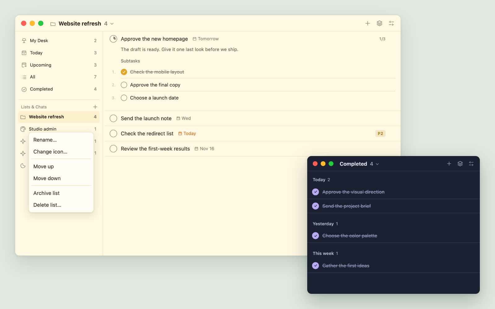

# TinyTasks v0.2.1

More control over your sidebar, quieter list management, and a clearer view of what is done.

- Empty lists stay in the sidebar and no longer appear as empty groups in All.
- Personal tasks without a named chat appear in the sidebar.
- Right-click lists to rename, change icons, archive, delete, or move them up/down.
- Archive lists to `archive.md` beside `tasks.md`, preserving their Markdown structure,
  completed tasks, subtasks and order, notes, unknown attributes, and line endings.
  Interrupted archive moves recover without appending another copy; conflicting edits
  are preserved and reported. Deleting a list asks for confirmation.
- Drag the sidebar divider to resize it; width saves locally. Keyboard arrows also work.
- Drag list items to reorder them, or use Alt+Up/Down. The main views remain fixed.
- Enabling the sidebar in a narrow window expands the task window so the sidebar appears.
- An open list shows its icon and name in the toolbar without a redundant list group heading.
- Empty new-list fields dismiss when focus moves away, and the new-list plus icon is centered.
- Completed is the fifth main sidebar item; Upcoming has a clearer calendar-and-arrow icon.
- Completed supports grouping by Date completed with relative Today, Yesterday, This week,
  and Earlier headings, independently of the task ordering.

Existing task files remain compatible. Archived lists move to `archive.md` beside your
active `tasks.md`; successful archiving completes silently.

## Downloads and installation

**macOS — Apple silicon and Intel:** Download `TinyTasks-0.2.1-universal-macos.dmg`,
open it, and drag **TinyTasks.app** to **Applications**. Eject the image and launch
`/Applications/TinyTasks.app`. The ZIP contains the same app. The app and DMG are
Developer ID signed, separately notarized by Apple, and carry stapled tickets.

**Windows x64:** Run `TinyTasks-0.2.1-windows-x64-setup.exe`, or extract the portable ZIP
to a permanent folder and run `tinytasks.exe`. The installer installs WebView2 when needed;
portable users need the Microsoft Edge WebView2 runtime already installed. Windows binaries
are unsigned; Windows security controls may warn about or block an unsigned download.

Verify downloads against `SHA256SUMS.txt`. Settings provides the installed executable path
and a copyable MCP configuration. On Mac, the executable is
`/Applications/TinyTasks.app/Contents/MacOS/tinytasks`, with the `mcp` argument.
Updates are installed manually from the release page.

## Verification

Rust and real MCP protocol checks passed on macOS and Windows. UI interaction checks
passed with fictional tasks and a mocked desktop bridge, including archive preservation
and recovery, context menus, resizing/reordering, error states, and completion-date grouping.
The Mac app and DMG passed signatures, stapled ticket, Gatekeeper, and packaged-content checks.
The installed app was visually checked on Apple silicon. Windows checks include x64
architecture, executable version, portable extraction, and MCP against the packaged executable.

An Intel Mac was not available for runtime testing. Native Windows desktop and installer
interaction were not tested. Windows installers are built on a GitHub-hosted Windows runner.
